# Giới thiệu

## Mục đích tài liệu

Tài liệu hướng dẫn người dùng Proterial sử dụng DW1 trên cổng Digital Worker (gọi tắt là cổng DW) từ lần đăng nhập đầu tiên. Mỗi vai có một chương riêng, viết theo từng bước bấm trên màn hình, không đòi hỏi kiến thức về phần mềm. Hình minh hoạ trong tài liệu dùng dữ liệu mẫu, không phải dữ liệu thật của Proterial.

## DW1 làm gì

DW1 là nhân sự số (Digital Worker) hỗ trợ bộ phận Sales xử lý đơn hàng (PO) và yêu cầu báo giá (RFQ) gửi đến qua email. DW1 đọc thư và tệp đính kèm, mở hồ sơ, đối chiếu với dữ liệu chủ và quy tắc của công ty, gắn cờ những điểm cần người xem, rồi soạn sẵn tệp nhập Bravo và thư trả lời khách. Người của Proterial vẫn là người quyết định: DW1 không tự xác nhận đơn, không tự gửi báo giá và không tự ghi vào Bravo.

| DW1 làm | Người dùng làm |
|---|---|
| Đọc thư, tệp PO, tệp RFQ; mở hồ sơ hoặc gắn vào hồ sơ có sẵn | Xem lại giá trị DW1 đọc, mở bản gốc để đối chiếu |
| Kiểm tra mã hàng, giá, số lượng, ngày giao, NOC/ESF theo quy tắc | Quyết định từng cờ: chấp nhận có lý do hoặc yêu cầu khách sửa |
| Soạn tệp nhập Bravo, thư xác nhận, thư yêu cầu khách sửa | Nhập Bravo, gửi thư, ghi số đơn Bravo |
| Chuyển cho Sales những thư DW1 không xử lý được, kèm lý do | Xử lý thư được chuyển, kiểm chéo, duyệt báo giá |

## Ai đọc chương nào

Mỗi người dùng chỉ cần đọc Chương 2, Chương 3 và chương của vai mình.

| Vai trên cổng DW | Công việc chính | Chương cần đọc |
|---|---|---|
| Sales phụ trách (PIC) | Xử lý hộp thư, đơn hàng, báo giá; kiểm chéo đơn của người khác | Chương 4 |
| Trưởng bộ phận Sales | Duyệt báo giá, mẫu PO, dữ liệu chủ, phiên bản quy tắc; cho DW1 chạy lại | Chương 4 và Chương 5 |
| Lãnh đạo (xem tổng hợp) | Xem số liệu tổng hợp của quy trình | Chương 6 |
| IT / Quản trị hệ thống | Tạo tài khoản, gán vai, đặt lại mật khẩu, khoá đăng nhập | Chương 7 |

Một người có thể giữ nhiều vai, ví dụ Sales phụ trách kiêm người duyệt báo giá thay. Khi đó cổng DW hiện đủ các chức năng của mọi vai người đó giữ.

## Thuật ngữ

| Thuật ngữ | Giải thích |
|---|---|
| Hồ sơ | Một đơn hàng hoặc một yêu cầu báo giá, từ lúc nhận thư đến lúc đóng |
| Cờ | Điểm DW1 phát hiện cần người xem, ví dụ giá lệch quy tắc, mã hàng chưa có trong bảng quy đổi |
| Cờ chặn | Cờ phải được quyết định trước khi hồ sơ đi tiếp |
| Mở nguồn | Mở bản gốc (trang PDF hoặc ô Excel) nơi DW1 đọc ra một giá trị; cổng DW yêu cầu mở nguồn trước khi xác nhận |
| Kiểm chéo | Một Sales khác đối chiếu đơn đã nhập Bravo với PO; người chuẩn bị đơn không tự kiểm chéo |
| YCBG | Yêu cầu báo giá nội bộ lập trên Bravo để gửi Design |
| Mẫu PO | Cách DW1 đọc mẫu PO của một khách; DW1 tự học ở PO đầu tiên, người lập tay chỉ khi DW1 không học được |
| Dữ liệu chủ | Danh mục khách hàng, mã hàng, bảng quy đổi mã, báo giá còn hiệu lực, giá LME |
| Phiên bản quy tắc | Bộ quy tắc kiểm tra mà DW1 đang áp dụng; mỗi thay đổi là một phiên bản mới, có người duyệt |
| Tạm dừng DW1 | Dừng DW1 xử lý thư mới trong workspace; các bước của Sales vẫn làm bình thường |

# Bắt đầu sử dụng

## Đăng nhập lần đầu

Tài khoản do IT của Proterial tạo trên cổng DW. IT đưa trực tiếp cho người dùng địa chỉ cổng DW, email đăng nhập và một mật khẩu tạm.

1. Mở trình duyệt (Chrome hoặc Edge), vào địa chỉ cổng DW do IT cung cấp.
2. Bấm **Đăng nhập**. Trang đăng nhập "Đăng nhập vào tài khoản của bạn" hiện ra.
3. Nhập email công ty vào ô **Tên người dùng hoặc email** và mật khẩu tạm vào ô **Mật khẩu**, bấm **Đăng nhập**.
4. Trang **Cập nhật mật khẩu** hiện thông báo "Bạn cần thay đổi mật khẩu để kích hoạt tài khoản". Nhập mật khẩu mới hai lần vào **Mật khẩu mới** và **Xác nhận mật khẩu**, bấm **Gửi**.
5. Cổng DW mở trang **Việc cần làm** (với người dùng Sales) hoặc trang chủ (với các vai khác).

Mật khẩu mới phải có ít nhất 10 ký tự và không trùng với email. Mật khẩu tạm chỉ dùng được một lần; sau bước 4 mật khẩu tạm không còn hiệu lực.

## Đổi mật khẩu và quên mật khẩu

Người dùng tự đổi mật khẩu bất cứ lúc nào.

1. Bấm vào tên của mình ở góc phải thanh trên cùng.
2. Chọn **Đổi mật khẩu**.
3. Nhập mật khẩu mới hai lần, bấm **Gửi**. Cổng DW quay lại đúng trang đang mở.

Khi quên mật khẩu, người dùng liên hệ IT. IT đặt lại mật khẩu tạm trên cổng DW (mục 7.3) và đưa trực tiếp cho người dùng; lần đăng nhập sau người dùng đặt lại mật khẩu riêng như lần đầu. Nhập sai mật khẩu nhiều lần liên tiếp, tài khoản bị khoá tạm thời và tự mở sau ít phút.

## Bố cục màn hình

Mọi trang của cổng DW có cùng một bố cục.

| Vùng | Vị trí | Nội dung |
|---|---|---|
| Thanh menu | Trên cùng | Các trang người dùng được vào: Việc cần làm, Hộp thư, Hồ sơ, Quản lý. Con số cạnh mục là số việc đang chờ |
| Chuông thông báo | Góc phải | Việc mới giao cho mình, yêu cầu duyệt, kết quả duyệt |
| Menu tài khoản | Góc phải, bấm vào tên | Vai đang giữ, Nhật ký hoạt động (nếu có quyền), Đổi mật khẩu, Đăng xuất |
| Thanh trạng thái DW1 | Dưới thanh menu, trên các trang Sales | DW1 đang chạy hay tạm dừng, đã xử lý bao nhiêu thư, nút Tạm dừng DW1 |

Trên màn hình nhỏ (điện thoại), thanh menu thu vào nút ba gạch ở góc trái.

## Quy ước chung trên màn hình

Một số quy ước áp dụng ở mọi trang.

- **Giờ Việt Nam:** mọi ngày giờ trên cổng DW là giờ Việt Nam.
- **Nút bị mờ:** nút mờ là việc người dùng chưa làm được lúc này. Rê chuột vào nút (hoặc đọc dòng chữ cạnh nút) để xem lý do, ví dụ "Bạn đã chuẩn bị đơn này nên không tự kiểm chéo được".
- **"Đã ẩn":** giá trị người dùng không có quyền xem hiện "Đã ẩn", không phải số 0 hay ô trống.
- **Giá trị máy đọc:** giá trị DW1 đọc từ tài liệu được đánh dấu; giá trị chỉ được coi là đã kiểm khi người dùng mở nguồn và xác nhận.
- **Danh sách dài:** bảng cuộn bên trong khung của nó, tiêu đề cột luôn hiện ở trên.
- **Đường dẫn chia sẻ được:** bộ lọc, ô tìm kiếm và hồ sơ đang mở nằm trên đường dẫn; gửi đường dẫn cho đồng nghiệp là họ thấy đúng màn hình đó (theo quyền của họ).

## Đăng xuất

Bấm vào tên ở góc phải, chọn **Đăng xuất**. Phiên đăng nhập tự kết thúc sau khoảng một ca làm việc; cổng DW báo trước 5 phút và cho phép bấm **Tiếp tục phiên**.

# Quy trình DW1

## Quy trình đơn hàng

Một đơn hàng đi qua các trạng thái theo thứ tự dưới đây. Trang Pipeline hồ sơ hiện mỗi trạng thái là một cột.

| Trạng thái | Ai đang giữ | Việc ở bước này |
|---|---|---|
| Đã nhận | DW1 | DW1 đọc thư và tệp PO |
| Đã kiểm tra | DW1 | DW1 đối chiếu với dữ liệu chủ và quy tắc, gắn cờ |
| Chờ PIC tự kiểm | Sales phụ trách | Xem từng cờ, mở nguồn, quyết định |
| Chờ khách sửa PO | Khách hàng | Đã gửi yêu cầu khách sửa; bản PO sửa (Rev.) tự gắn vào hồ sơ |
| PIC đã tự kiểm | Sales phụ trách | Tải tệp nhập Bravo, nhập Bravo |
| Đã nhập Bravo | Sales khác | Kiểm chéo đơn trên Bravo với PO |
| Đã kiểm chéo | Sales phụ trách | Gửi xác nhận cho khách |
| Đã xác nhận | – | Đơn đã xác nhận với khách |
| Xem thay đổi PO | Sales phụ trách | Khách gửi thay đổi sau khi đã xác nhận |
| Đã đóng | – | Kết thúc (kèm lý do đóng) |

## Quy trình báo giá

Một yêu cầu báo giá đi qua các trạng thái sau.

| Trạng thái | Ai đang giữ | Việc ở bước này |
|---|---|---|
| Đã nhận | Sales phụ trách | Xem yêu cầu, soạn YCBG |
| Đã soạn YCBG, Đã lập YCBG trên Bravo | Sales phụ trách | Lập YCBG trên Bravo, ghi số YCBG |
| Chờ Design | Design | Design phản hồi qua email; phản hồi tự gắn vào hồ sơ |
| Design đã phản hồi, Thảo luận spec với khách | Sales phụ trách | Thống nhất spec với khách nếu cần |
| Đã định giá | Sales phụ trách | Ghi giá, MOQ, lead time và căn cứ giá |
| Chờ duyệt | Người duyệt báo giá | Duyệt hoặc trả lại định giá |
| Đã duyệt, Đã gửi khách | Sales phụ trách | Gửi báo giá cho khách |
| Đã ghi master list | – | Ghi vào master list, kết thúc |

Người định giá không tự duyệt báo giá của mình; người kiểm chéo đơn phải khác người chuẩn bị đơn. Cổng DW chặn hai trường hợp này ngay trên nút bấm.

# Hướng dẫn cho Sales phụ trách

## Việc cần làm

Trang **Việc cần làm** là trang mở đầu mỗi ngày: liệt kê mọi việc đang chờ người dùng, việc có hạn xếp trước, rồi đến việc chờ lâu nhất.

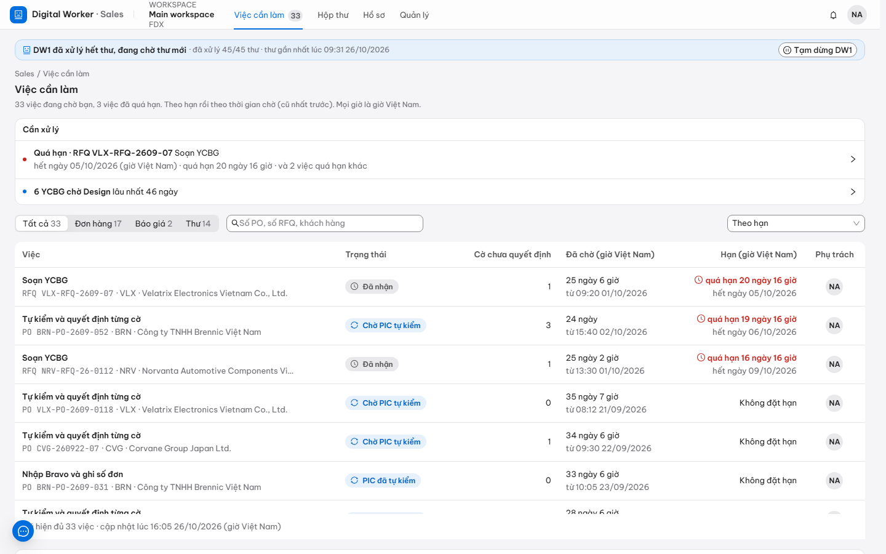

1. Khung **Cần xử lý** ở trên cùng nêu việc quá hạn và việc chờ lâu nhất. Bấm vào một dòng để mở danh sách tương ứng.
2. Chọn thẻ **Đơn hàng**, **Báo giá** hoặc **Thư** để lọc; gõ số PO, số RFQ hoặc tên khách vào ô tìm kiếm.
3. Bấm vào tên việc (ví dụ "Tự kiểm và quyết định từng cờ") để mở hồ sơ và làm tiếp.

Cột **Cờ chưa quyết định** cho biết còn bao nhiêu cờ phải xem; cột **Hạn** hiện chữ đỏ khi đã quá hạn.

Mỗi sáng ngày làm việc, chuông thông báo có **Tóm tắt sáng**: số hồ sơ mới, số sắp đến hạn và quá hạn, việc đang chờ ai. Khi máy chủ có mô hình và quy tắc nhắc việc để bật **DW1 viết đoạn mở đầu** (mặc định bật), DW1 viết thêm vài câu ở đầu (bắt đầu bằng "DW1 viết:") về việc nên làm trước hôm nay, nêu đúng số PO hoặc RFQ. Câu nào có con số, ngày hay mã không đúng với hồ sơ thì DW1 bỏ cả đoạn và gửi tóm tắt như thường; các con số đếm bên dưới luôn có.

## Hộp thư

Trang **Hộp thư** liệt kê thư khách gửi vào hộp thư Sales, cùng hướng xử lý của DW1 cho từng thư.

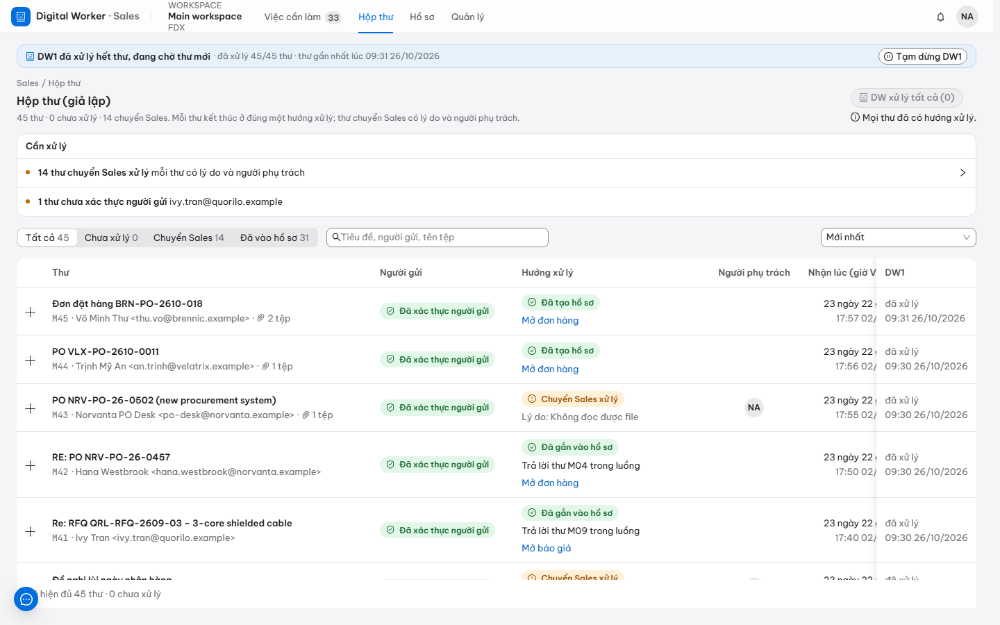

DW1 tự xử lý thư mới. Người dùng cũng có thể bấm **DW xử lý** trên một thư, hoặc **DW xử lý tất cả** để xếp mọi thư chưa xử lý; thư chuyển "Đang chờ DW1", rồi "DW1 đang xử lý", rồi có kết quả. Mỗi thư có một trong các kết quả sau.

| Kết quả | Ý nghĩa | Người dùng làm gì |
|---|---|---|
| Đã tạo hồ sơ | DW1 mở hồ sơ đơn hàng hoặc báo giá mới | Mở hồ sơ từ Việc cần làm |
| Đã gắn vào hồ sơ | Thư thuộc hồ sơ có sẵn (bản PO sửa, phản hồi Design, trả lời của khách) | Xem hồ sơ đó |
| Chuyển Sales xử lý | DW1 không xử lý thư này; dòng thư ghi lý do và người phụ trách | Đọc thư và xử lý như thường lệ |
| DW1 chưa xử lý được | Có lỗi khi đọc thư; dòng thư ghi lý do | Bấm **DW xử lý lại**, hoặc báo IT nếu lỗi lặp lại |

Nếu DW1 không đọc được một tệp thư (tệp hỏng hoặc lớn hơn 20 MB), thư đó không vào Hộp thư. DW1 gửi thông báo "Có thư DW1 không đọc được" kèm tên tệp cho người xử lý hộp thư; mở thư gốc trong Outlook và xử lý tay. Nếu DW1 không đọc được cả thư mục thư, người xử lý hộp thư nhận thông báo "DW1 không đọc được thư mục thư", mỗi ngày một lần cho tới khi thư mục được nối lại; báo IT.

Thư từ một địa chỉ không thuộc khách nào (người mua viết từ hộp thư mới, hộp thư cá nhân) được chuyển Sales với lý do "Chưa xác định được khách hàng". Mở dòng thư: DW1 đọc chữ ký và tên người gửi, đoán thư của khách nào và trích câu trong thư làm căn cứ (gắn nhãn "Máy đoán"). Nếu đúng, bấm **Đúng, ghi nhớ và xử lý lại**; nếu sai, chọn khách khác trong danh sách rồi bấm **Ghi nhớ và xử lý lại**. DW1 ghi nhớ địa chỉ người gửi đó là của khách đã chọn (chỉ địa chỉ này, không cả tên miền) và xử lý lại thư; thư sau từ địa chỉ này được nhận đúng khách ngay. Nếu thư ký tên một công ty không có trong danh sách, DW1 nêu tên đó: có thể là khách mới, thêm vào Dữ liệu chủ.

Thư phản hồi Design đến trước khi hồ sơ báo giá có số YCBG sẽ được chuyển Sales. Sau khi ghi số YCBG, bấm **DW xử lý lại** trên thư phản hồi để DW1 gắn thư vào đúng hồ sơ.

## Xử lý đơn hàng

Mỗi đơn hàng có một trang hồ sơ: thông tin khách, các dòng PO, các cờ, tệp và thư nháp DW1 soạn, hành trình hồ sơ.

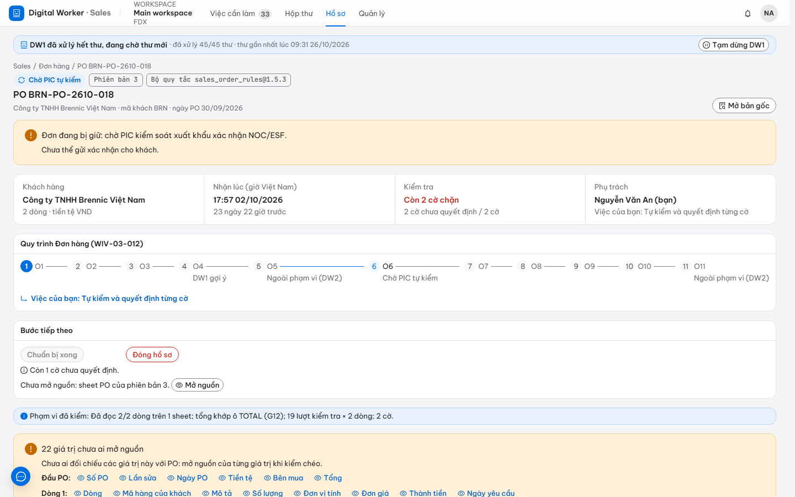

### Tự kiểm và quyết định cờ

Mọi cờ chặn phải được quyết định trước khi đơn đi tiếp; không có nút "chấp nhận tất cả".

1. Mở hồ sơ từ **Việc cần làm** hoặc **Hồ sơ → Đơn hàng**.
2. Bấm **Mở bản gốc** hoặc **Mở nguồn** cạnh giá trị cần xem. Trang PDF hoặc bảng Excel hiện ra, khung quanh đúng chỗ DW1 đã đọc.
3. Chưa rõ một cờ nghĩa là gì, bấm **DW1 giải thích**: DW1 viết vài câu về điều đã so sánh, các giá trị, và nên kiểm gì tiếp, chỉ dùng số liệu có trong hồ sơ (gắn nhãn "Máy viết"). DW1 không quyết thay; người vẫn chọn cách xử lý.
4. Với từng cờ, chọn một trong hai:
   - **Chấp nhận + lý do**: nhập lý do, ví dụ "Khách xác nhận giá theo thư ngày 22/09".
   - **Yêu cầu khách sửa**: dòng này cần khách gửi lại PO.
5. Bấm **Ghi quyết định**. Mỗi quyết định tạo một phiên bản hồ sơ mới.
6. Khi mọi cờ đã quyết định, bấm **Chuẩn bị xong**. Nếu nút mờ với lý do "Chưa mở nguồn", bấm **Mở nguồn** của phiên bản hồ sơ hiện tại rồi bấm lại.

Khi một dòng có mã hàng của khách chưa có trong bảng quy đổi, DW1 gợi ý các mã PRV khớp mô tả; Sales chọn mã đúng. DW1 ghi nhớ lựa chọn đó: PO sau của cùng khách có cùng mã hàng sẽ tự khớp mã PRV, không phải chọn lại. Lần chọn đầu tiên được giữ; bảng quy đổi chính thức (nhập từ Excel) luôn được ưu tiên khi đã có mã đó.

Cờ "Thiếu NOC/ESF" chỉ người được giao kiểm soát xuất khẩu chấp nhận được; trong lúc chờ, hồ sơ báo "Đơn đang bị giữ: chờ PIC kiểm soát xuất khẩu xác nhận NOC/ESF".

### Yêu cầu khách sửa PO

1. Quyết định các cờ cần khách sửa bằng **Yêu cầu khách sửa** → **Ghi quyết định**.
2. Bấm **Gửi yêu cầu khách sửa**. DW1 soạn thư nháp liệt kê đúng các dòng cần sửa; người dùng tải thư, gửi từ hộp thư của mình.
3. Hồ sơ chuyển "Chờ khách sửa PO". Khi khách gửi bản sửa (Rev.1, Rev.2…), DW1 tự gắn vào cùng hồ sơ, hiện bảng thay đổi so với bản trước và kiểm tra lại từ đầu.

### Nhập Bravo và ghi số đơn

1. Trong khung **Tệp và thư nháp DW1 soạn**, bấm soạn rồi **Tải** tệp nhập Bravo (Excel).
2. Nhập đơn trên Bravo bằng tệp vừa tải.
3. Bấm **Đã nhập Bravo**, nhập số đơn Bravo, xác nhận đã đối chiếu với PO, bấm **Ghi số đơn Bravo**.
4. Hồ sơ chuyển "Đã nhập Bravo" và chờ một Sales khác kiểm chéo.

### Gửi xác nhận cho khách

Sau khi đơn đã được kiểm chéo:

1. Bấm **Đã gửi xác nhận**.
2. Nhập ngày xác nhận cho từng dòng. Cột "DW1 gợi ý" chỉ là đề xuất; người dùng sửa theo ngày thật.
3. Bấm **Ghi đã gửi xác nhận**. Thư nháp xác nhận ghi tên người chuẩn bị và người kiểm chéo.

## Kiểm chéo đơn của người khác

Đơn đã nhập Bravo cần một Sales khác người chuẩn bị đối chiếu lại. Danh sách đơn chờ kiểm chéo nằm ở **Hồ sơ → Kiểm chéo & duyệt** và trong **Việc cần làm**.

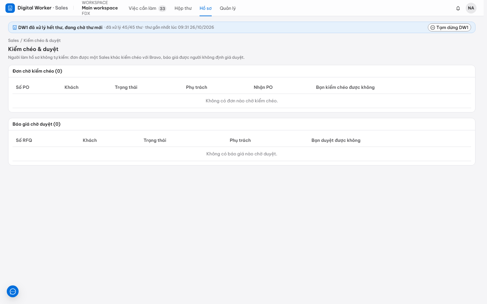

1. Mở hồ sơ, bấm **Mở nguồn** để xem bản gốc.
2. Đối chiếu đơn trên Bravo với PO.
3. Bấm **Kiểm chéo đạt**, ghi chú đã đối chiếu những gì, bấm **Ghi kiểm chéo đạt**. Nếu có sai lệch, chọn **Trả lại cho người chuẩn bị** kèm lý do.

Người đã chuẩn bị đơn thấy nút **Kiểm chéo đạt** bị mờ, kèm lý do tách nhiệm.

## Xử lý báo giá

Mỗi yêu cầu báo giá có một trang hồ sơ: yêu cầu của khách, YCBG, phản hồi Design, căn cứ giá và tài liệu báo giá.

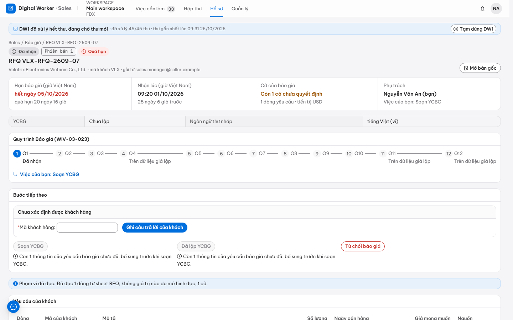

### Lập YCBG và gửi Design

1. Mở hồ sơ báo giá, bấm **Mở nguồn** để xem yêu cầu gốc của khách.
2. Bấm **Soạn YCBG**, rồi lập YCBG trên Bravo.
3. Bấm **Đã lập YCBG**, nhập số YCBG, bấm **Ghi số YCBG**.
4. Bấm **Gửi Design**. Khi Design trả lời qua email, thư phản hồi tự gắn vào hồ sơ.

### Định giá và trình duyệt

1. Xem khung căn cứ giá: lịch sử báo giá, lịch sử đặt hàng, giá LME, phần đồng. Mục "Giá đã báo cho khách khác" chỉ hiện với người được giao quyền xem; người khác thấy "Đã ẩn".
2. Bấm **Ghi giá**: nhập đơn giá, MOQ, lead time và căn cứ giá.
3. Bấm **Trình duyệt**, nhập số báo giá. DW1 soạn tài liệu báo giá (Excel và PDF) để người duyệt xem trước.

### Gửi báo giá cho khách

Sau khi báo giá được duyệt:

1. Trong khung **Tệp và thư nháp DW1 soạn**, tải tài liệu báo giá và thư gửi khách.
2. Gửi cho khách từ hộp thư của mình, bấm **Đã gửi KH**.
3. Bấm **Xác nhận master list** khi đã ghi vào master list.

## Mẫu PO mới

Khi một khách gửi PO theo mẫu DW1 chưa biết, DW1 tự học mẫu đó: AI đọc tiêu đề các cột, DW1 kiểm số lượng × đơn giá khớp thành tiền, tổng cộng khớp, mã hàng có thật và giá nằm trong khoảng đã báo. Mọi kiểm tra đều qua thì DW1 dùng mẫu đó luôn và mở hồ sơ đơn hàng, không ai phải duyệt. Với vài PO đầu theo mẫu mới, DW1 gắn cờ mọi giá trị để Sales xác nhận bên cạnh tệp gốc.

Chỉ khi DW1 không học được (thư hiện "Không đọc được file"), Sales lập mẫu tay và Trưởng bộ phận Sales duyệt:

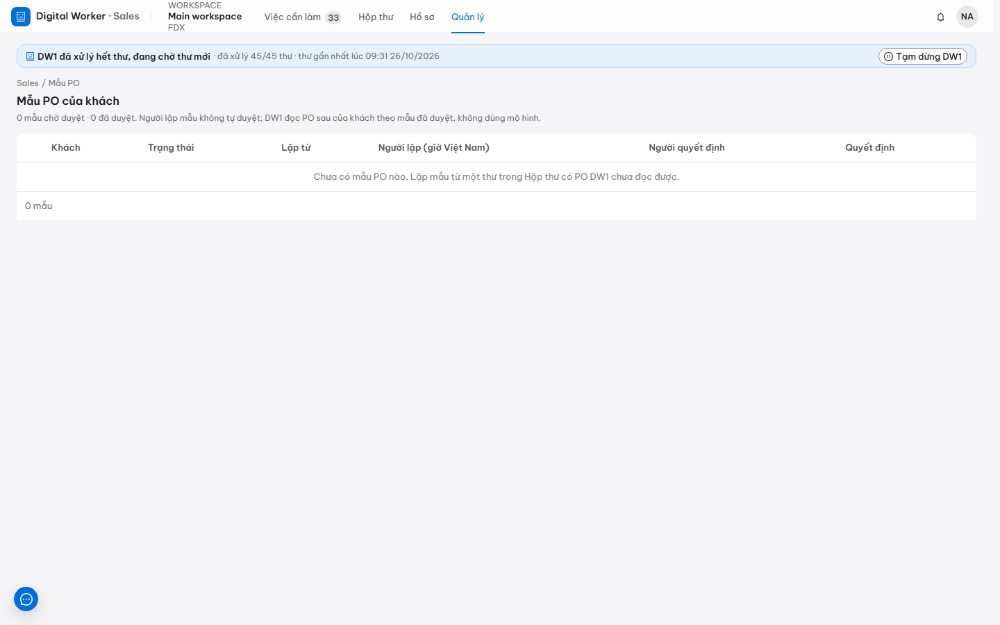

1. Ở **Hộp thư**, mở dòng thư, bấm **Thiết lập mẫu PO** cạnh tệp PO.
2. Gán từng trường (số PO, ngày PO, mã hàng, số lượng, đơn giá…) với nhãn in trên mẫu.
3. Bấm **Xem thử**. Khi cổng DW báo "Mọi kiểm tra đạt", bấm **Gửi duyệt**.
4. Sau khi mẫu được duyệt, bấm **DW xử lý lại** trên thư. Với ba PO đầu tiên theo mẫu mới, DW1 gắn cờ mọi giá trị để Sales xác nhận.

## Nhập dữ liệu chủ từ tệp

Danh mục khách hàng, mã hàng, bảng quy đổi mã, báo giá còn hiệu lực và giá LME được nhập từ tệp Excel; dữ liệu mới chỉ có hiệu lực sau khi Trưởng bộ phận Sales duyệt.

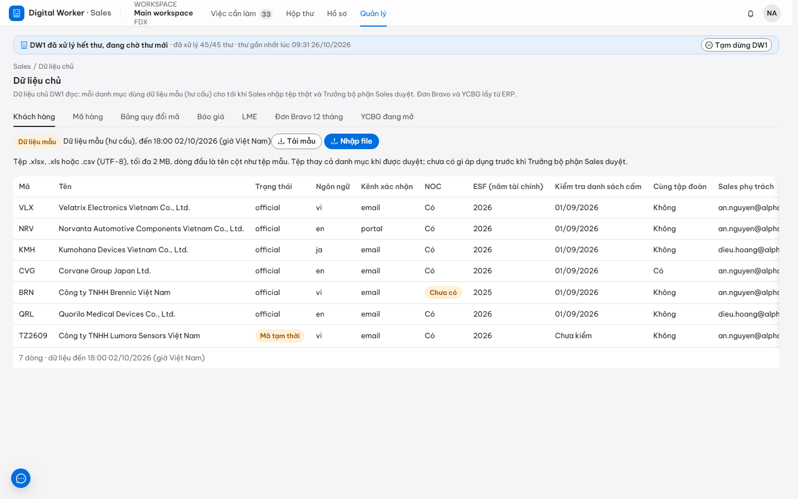

1. Mở **Quản lý → Dữ liệu chủ**, chọn danh mục cần cập nhật.
2. Bấm **Nhập file**, chọn tệp Excel.
3. Xem bảng xem trước: số dòng thêm, sửa, bỏ và các dòng bị từ chối kèm lý do.
4. Bấm **Gửi duyệt**. Cổng DW báo "Đã gửi duyệt. Trưởng bộ phận Sales quyết trên trang Duyệt."

## Xem toàn bộ hồ sơ

Trang **Hồ sơ → Pipeline hồ sơ** hiện mọi hồ sơ theo trạng thái: mỗi cột là một trạng thái, thẻ viền xanh là việc đang đến lượt người dùng.

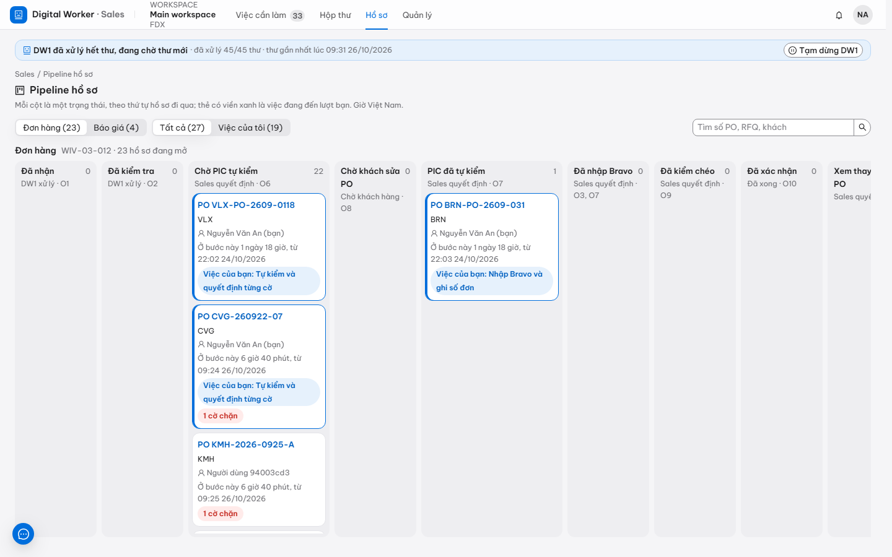

- Chọn **Đơn hàng** hoặc **Báo giá** để đổi quy trình; chọn **Việc của tôi** để chỉ xem hồ sơ đang chờ mình.
- Mỗi cột cuộn riêng; bấm vào số PO hoặc RFQ trên thẻ để mở hồ sơ.
- Trang **Hồ sơ → Đơn hàng** và **Hồ sơ → Báo giá** hiện cùng các hồ sơ dưới dạng bảng, lọc được theo trạng thái.
- Trên trang một hồ sơ, thẻ **Tóm tắt chuỗi thư** có nút **DW1 tóm tắt**: DW1 đọc các thư của hồ sơ (PO, bản sửa, thư khách trả lời, phản hồi Design) và viết vài ý về điều đang diễn ra, mỗi ý kèm mã thư làm căn cứ; bấm mã thư để mở thư đó. Ý nào dùng con số không có trong thư được trích bị bỏ, và thẻ ghi rõ bao nhiêu ý bị bỏ. Bản tóm tắt gắn nhãn "Máy viết" và không được lưu.

## Sửa quy tắc

Quy tắc (khi nào DW1 nhắc việc, nội dung thư gửi khách, cách kiểm PO…) do Trưởng bộ phận Sales sửa, hoặc quản trị viên công ty đề xuất để Trưởng bộ phận duyệt. Trang **Quản lý → Quy tắc** ghi mỗi quy tắc quyết định điều gì; các quy tắc kỹ thuật (KPI, chữ trên tài liệu, mẫu nhập Bravo, thư chuyển PC/QA) nằm trong mục **Nâng cao**.

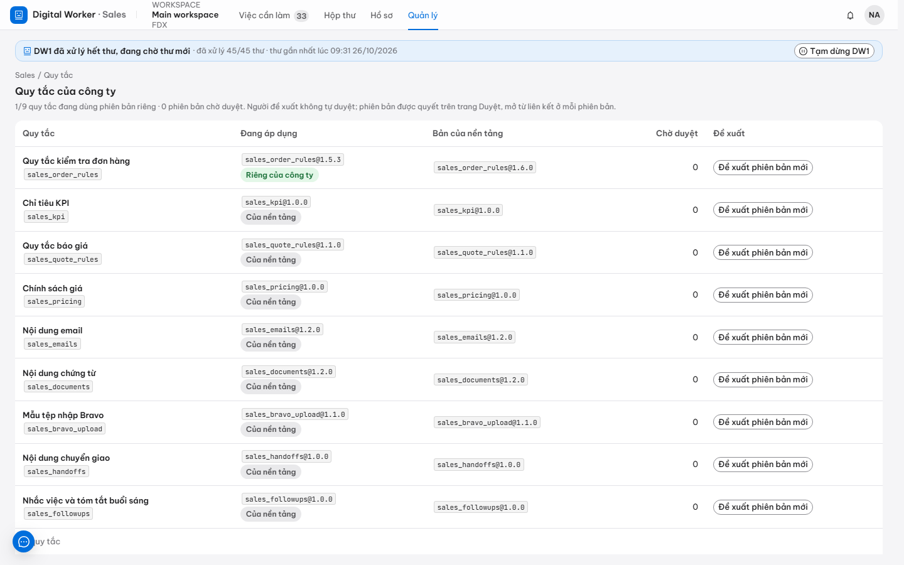

1. Bấm **Sửa quy tắc** (Trưởng bộ phận) hoặc **Đề xuất bản mới** ở dòng quy tắc cần sửa.
2. Ở ô **Muốn đổi gì?**, viết bằng lời thường, ví dụ "nhắc PIC sau 6 giờ thay vì 4 giờ", rồi bấm **DW1 soạn thay đổi**. Với **Nội dung email**, chọn loại thư rồi viết điều muốn đổi hoặc dán một thư ví dụ: DW1 viết lại thư ở mọi ngôn ngữ theo giọng và bố cục đó, còn mọi số liệu (số PO, số lượng, giá, ngày) vẫn do hệ thống điền.
3. Bản nháp DW1 soạn tự mở; mục nào DW1 đổi được gắn "Máy đọc". Có thể sửa tiếp trực tiếp trong biểu mẫu.
4. Bấm **Xem thay đổi** để đối chiếu với bản đang áp dụng, rồi gửi. Bản của Trưởng bộ phận áp dụng ngay; bản người khác đề xuất chờ Trưởng bộ phận duyệt trên trang **Duyệt**. Hồ sơ cũ giữ phiên bản đã dùng.

Nếu DW1 không hiểu yêu cầu, hoặc bản soạn bỏ hay thêm chỗ điền số liệu, tự viết một con số không có trong lời yêu cầu, hay đổi một mục quy tắc không có, bản nháp không được dùng và cổng DW nêu lý do; bản đang áp dụng vẫn mở để sửa tay.

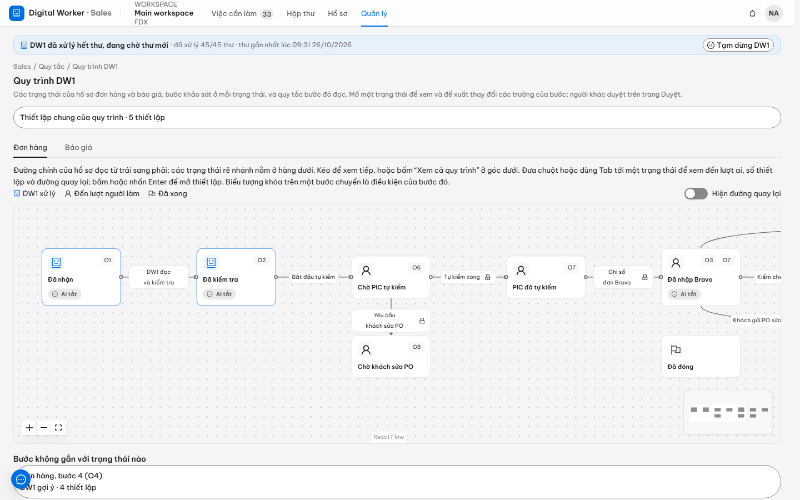

## Tạm dừng DW1

Khi cần dừng DW1 xử lý thư mới (ví dụ phát hiện DW1 đọc sai hàng loạt), bất kỳ Sales nào cũng có thể tạm dừng.

1. Trên thanh trạng thái DW1, bấm **Tạm dừng DW1**.
2. Nhập lý do, bấm **Tạm dừng DW1**.

Trong lúc tạm dừng, DW1 không xử lý thư mới; các bước của Sales trên hồ sơ vẫn làm được. Chỉ Trưởng bộ phận Sales cho DW1 chạy lại (mục 5.5).

# Hướng dẫn cho Trưởng bộ phận Sales

Trưởng bộ phận Sales dùng mọi chức năng ở Chương 4 và thêm các quyền duyệt dưới đây. Mọi yêu cầu duyệt đều cần nhận xét, và cổng DW không cho người làm hồ sơ tự duyệt hồ sơ của mình.

## Trang Duyệt

Trang **Duyệt** gom mọi yêu cầu đang chờ người dùng quyết định. Mở trang từ chuông thông báo hoặc từ thông báo trên các trang Sales.

| Loại yêu cầu | Quyết định ở đâu |
|---|---|
| Phiên bản quy tắc | Ngay trên trang Duyệt: xem thay đổi, ghi nhận xét, bấm **Duyệt** hoặc **Từ chối** |
| Dữ liệu chủ | Ngay trên trang Duyệt, như phiên bản quy tắc |
| Duyệt báo giá | Bấm **Mở hồ sơ để quyết định**, quyết định trên trang hồ sơ báo giá |
| Kiểm chéo đơn hàng | Bấm **Mở hồ sơ để quyết định** |
| Mẫu PO lập tay | Mở trang Mẫu PO từ đường dẫn trên thư trong **Hộp thư** |

## Duyệt báo giá

1. Mở hồ sơ báo giá đang "Chờ duyệt".
2. Trong khung **Tệp và thư nháp DW1 soạn**, xem bản xem trước tài liệu báo giá (PDF).
3. Xem căn cứ giá và các cờ. Với cờ giá chặn (nếu có), nhập lý do chấp nhận.
4. Ghi **Nhận xét khi duyệt**, bấm **Duyệt báo giá**. Nếu cần sửa, chọn **Trả lại định giá** kèm lý do.

Người duyệt báo giá thay (nếu được giao) làm theo đúng các bước trên.

## Duyệt mẫu PO

Mẫu DW1 tự học không cần duyệt. Mẫu do Sales lập tay chỉ có hiệu lực sau khi Trưởng bộ phận Sales duyệt; người lập mẫu không tự duyệt.

1. Mở trang Mẫu PO (đường dẫn trên thư trong **Hộp thư**, hoặc thông báo chờ duyệt), chọn mẫu đang chờ duyệt.
2. Xem phần xem thử: các trường DW1 đọc được từ PO mẫu.
3. Bấm **Duyệt**, ghi **Nhận xét**, bấm **Duyệt mẫu**.

## Duyệt phiên bản quy tắc và dữ liệu chủ

1. Mở trang **Duyệt**, chọn yêu cầu.
2. Xem phần thay đổi: với phiên bản quy tắc là các giá trị cũ và mới; với dữ liệu chủ là số dòng thêm, sửa, bỏ.
3. Ghi **Nhận xét (bắt buộc)**, bấm **Duyệt** hoặc **Từ chối**. Phiên bản quy tắc mới áp dụng cho các hồ sơ kiểm tra sau đó; dữ liệu chủ mới được dùng từ lần kiểm tra kế tiếp.

## Cho DW1 chạy lại

Khi DW1 đang tạm dừng, Trưởng bộ phận Sales nhận thông báo và là người duy nhất cho DW1 chạy lại.

1. Trên thanh trạng thái DW1, bấm **Tiếp tục DW1**.
2. Ghi lý do, bấm **Cho DW1 chạy lại**.

## Theo dõi DW1

Trang **Quản lý → Hoạt động DW1** cho biết mỗi bước DW1 tự làm bao nhiêu hồ sơ, chuyển cho người bao nhiêu và vì sao, theo từng ngày. Bấm vào một con số để mở danh sách hồ sơ tương ứng.

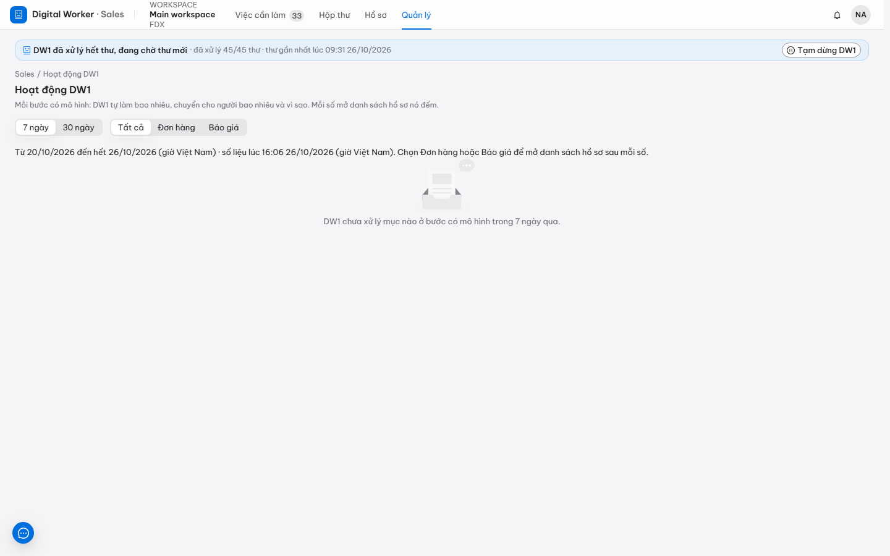

# Hướng dẫn cho Lãnh đạo

Lãnh đạo xem số liệu tổng hợp của quy trình, không xem chi tiết từng hồ sơ và không xem số tiền.

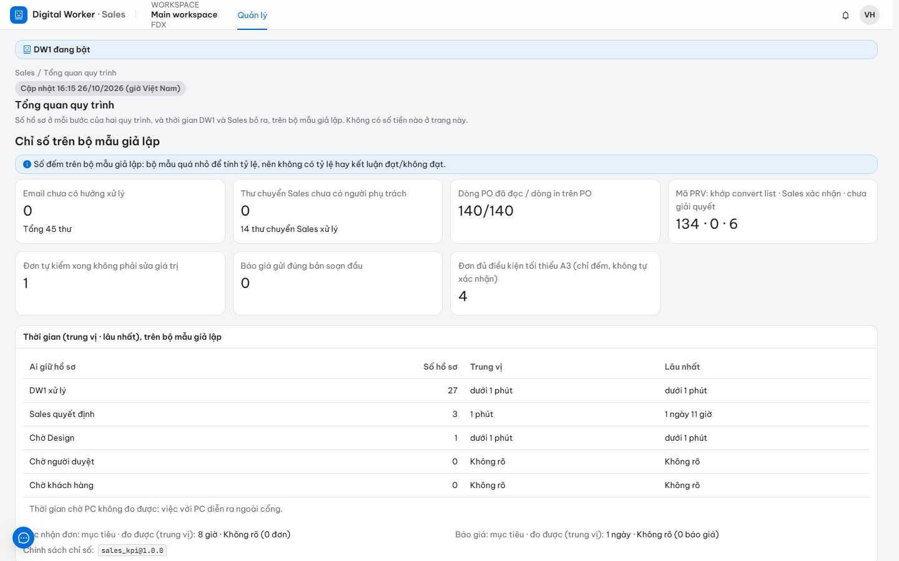

1. Mở **Quản lý → Tổng quan quy trình**: số hồ sơ ở mỗi bước của quy trình đơn hàng và báo giá, thời gian xử lý.
2. Mở **Quản lý → Hoạt động DW1**: phần việc DW1 tự làm và phần chuyển cho người theo từng ngày.

Các trang hồ sơ, hộp thư và dữ liệu chủ hiện "Bạn không có quyền xem mục này" với vai Lãnh đạo.

# Hướng dẫn cho IT và Quản trị hệ thống

IT quản lý tài khoản và quyền trên menu **Quản trị**, trang **Vai trò và quyền**, khung **Thành viên**. IT không xem nội dung hồ sơ và không xem giá.

## Thêm người dùng mới

1. Mở **Quản trị**, ở khung **Thành viên** bấm **Thêm người**.
2. Nhập **Họ và tên**, **Email công ty**, chọn **Vai**, bấm **Tạo tài khoản**.
3. Hộp thoại **Mật khẩu tạm** hiện mật khẩu một lần duy nhất. Ghi lại và đưa trực tiếp cho người dùng (không gửi vào nhóm chat chung), bấm **Đã ghi lại**.
4. Người dùng đăng nhập bằng email và mật khẩu tạm, rồi đặt mật khẩu riêng (mục 2.1).

Bảng vai IT có thể gán:

| Vai | Dùng cho |
|---|---|
| Sales phụ trách (PIC) | Nhân viên Sales xử lý đơn hàng, báo giá |
| Trưởng bộ phận Sales | Người duyệt báo giá, mẫu PO, dữ liệu chủ, quy tắc |
| Lãnh đạo (xem tổng hợp) | Ban lãnh đạo chỉ xem số liệu tổng hợp |

Vai quản trị hệ thống chỉ Quản trị toàn quyền mới gán được.

## Bộ quyền bổ sung

Ngoài vai, một người có thể cần thêm quyền riêng, ví dụ kiểm soát xuất khẩu (chấp nhận cờ NOC/ESF), xem giá đã báo cho khách khác, hoặc duyệt báo giá thay.

1. Ở dòng của người đó, bấm **Bộ quyền bổ sung**.
2. Đánh dấu bộ quyền cần cấp, bấm **Lưu bộ quyền**.

Cổng DW từ chối các tổ hợp quyền vi phạm tách nhiệm, ví dụ một người vừa quản trị thành viên vừa xem giá.

## Đặt lại mật khẩu và khoá đăng nhập

Các thao tác dưới đây nằm ở dòng của từng người trong khung Thành viên.

- **Đặt lại mật khẩu:** bấm **Đặt lại mật khẩu**, xác nhận. Cổng DW hiện mật khẩu tạm mới một lần; mật khẩu cũ ngừng dùng được ngay.
- **Khoá đăng nhập:** khi nhân viên nghỉ việc hoặc mất máy, bấm **Khoá đăng nhập**, xác nhận. Người đó bị đăng xuất ngay và không đăng nhập được; vai và dữ liệu giữ nguyên.
- **Mở khoá đăng nhập:** bấm **Mở khoá đăng nhập** để cho đăng nhập lại.
- **Gỡ khỏi workspace:** bấm biểu tượng thùng rác ở dòng của người đó để gỡ mọi vai trong workspace hiện tại.

IT không tự khoá đăng nhập của chính mình, và chỉ Quản trị toàn quyền thao tác được trên tài khoản của một quản trị viên.

## Việc làm trên trang quản trị đăng nhập

Một số việc ít gặp làm trên trang quản trị đăng nhập (Keycloak), tại địa chỉ `<địa chỉ đăng nhập>/admin/dw/console/`. IT đăng nhập bằng chính tài khoản cổng DW của mình; tài khoản cần thuộc nhóm `dw-it`, do FPT thêm khi bàn giao. Trang quản trị chỉ hiện hai mục Users và Groups: phần cấu hình hệ thống do FPT quản lý nên không hiện cho IT.

| Việc | Cách làm |
|---|---|
| Mở khoá người nhập sai mật khẩu nhiều lần | Users → chọn người → tắt "Temporarily locked" |
| Đăng xuất một người khỏi mọi thiết bị | Users → chọn người → Sessions → Sign out |
| Yêu cầu một người cài xác thực hai lớp (OTP) | Users → chọn người → ô "Required user actions" → chọn "Configure OTP" → Save; lần đăng nhập sau người đó được hướng dẫn cài |

Không tạo người dùng trực tiếp trên trang quản trị đăng nhập: tài khoản tạo ở đó không có vai trên cổng DW và không đặt lại mật khẩu được từ khung Thành viên.

## Việc nền lỗi

Một số việc DW chạy nền, không do ai bấm chờ: đọc tệp dữ liệu chủ vừa tải lên, áp dụng phiên bản quy tắc hoặc mẫu PO vừa được duyệt, tạo quy tắc từ tệp mẫu. Khi một việc lỗi, DW thử lại tối đa 5 lần, các lần cách nhau 30 giây, 1 phút, 2 phút, 4 phút, nên một dịch vụ khởi động lại vài phút không làm mất việc. Hết 5 lần mà vẫn lỗi, việc dừng lại và quản trị viên công ty nhận thông báo "Một việc nền đã dừng".

Mở **Quản trị → Việc nền lỗi** để xem các việc đang dừng, lúc phát sinh và loại lỗi. Khắc phục nguyên nhân trước (ví dụ dịch vụ đọc tệp đang tắt), rồi bấm **Chạy lại**. Mỗi lần chạy lại được ghi vào nhật ký kiểm toán. Trang chỉ hiện loại lỗi; nội dung lỗi đầy đủ nằm trong nhật ký của worker, gửi FPT khi cần.

# Câu hỏi thường gặp

## Thư đứng mãi ở "Đang chờ DW1"

DW1 xử lý lần lượt, thư cũ trước. Nếu thư đứng quá vài phút, kiểm tra thanh trạng thái DW1: DW1 có đang tạm dừng không. Nếu DW1 đang chạy mà thư vẫn đứng, báo IT.

## Nút bị mờ, không bấm được

Rê chuột vào nút hoặc đọc dòng chữ cạnh nút để xem lý do. Các lý do thường gặp:

| Lý do hiện trên màn hình | Cách xử lý |
|---|---|
| Chưa mở nguồn | Bấm **Mở nguồn** của phiên bản hồ sơ hiện tại |
| Bạn đã chuẩn bị đơn này nên không tự kiểm chéo được | Nhờ một Sales khác kiểm chéo |
| Bạn đã định giá báo giá này nên không tự duyệt được | Nhờ người duyệt khác |
| Chỉ Trưởng bộ phận Sales … | Việc này thuộc quyền Trưởng bộ phận Sales |

## Không thấy giá, hiện "Đã ẩn"

Người dùng chưa được cấp quyền xem giá đó. Liên hệ Trưởng bộ phận Sales hoặc IT nếu công việc cần.

## Trang báo "Bạn không có quyền xem mục này"

Vai của người dùng không bao gồm trang này. Liên hệ IT để kiểm tra vai và bộ quyền bổ sung.

## Thư báo hết lượt chạy DW1 trong ngày

Thư còn lại ở "Chưa xử lý" với lý do "Hết lượt chạy DW1 trong ngày của gói" và được DW1 tự xử lý lại sau. Nếu thường xuyên gặp, báo IT để xem lại gói sử dụng.

## Quên mật khẩu hoặc tài khoản bị khoá

Liên hệ IT để đặt lại mật khẩu (mục 7.3). Nếu nhập sai nhiều lần, tài khoản tự mở sau ít phút.
